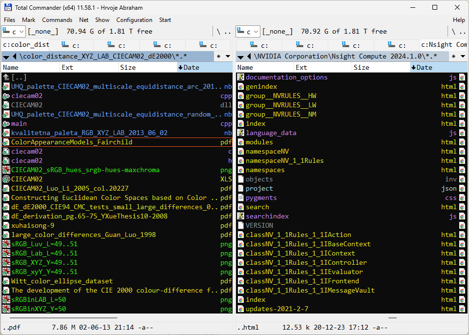
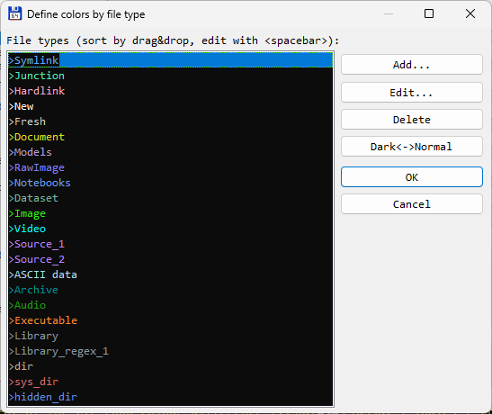
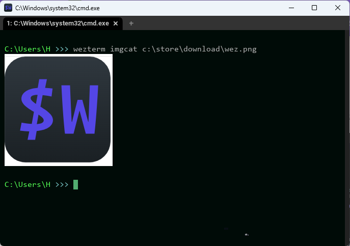

# Configurations
Configurations of the most used apps &amp; utilities.

## Total Commander
The profile includes 23 file-color rules, keyboard shortcuts and three custom column views. The link colors use the NTLinks content plugin. [Set up the Total Commander profile](totalcmd/README.md).





# Wezterm



# Clink

default_inputrc:
```
# Completion commands
# https://chrisant996.github.io/clink/clink.html#completion-commands
# 
#           complete
"\e[1;5B":  possible-completions    # Ctrl-Down
#           insert-completions
"\t":       menu-complete           # Tab
"\e[Z":     menu-complete-backward  # Shift-Tab
#           old-menu-complete
#           delete-char-or-list
```

clink_settings:
```
# name: Enable automatic suggestions
# type: boolean
autosuggest.enable = False
```
